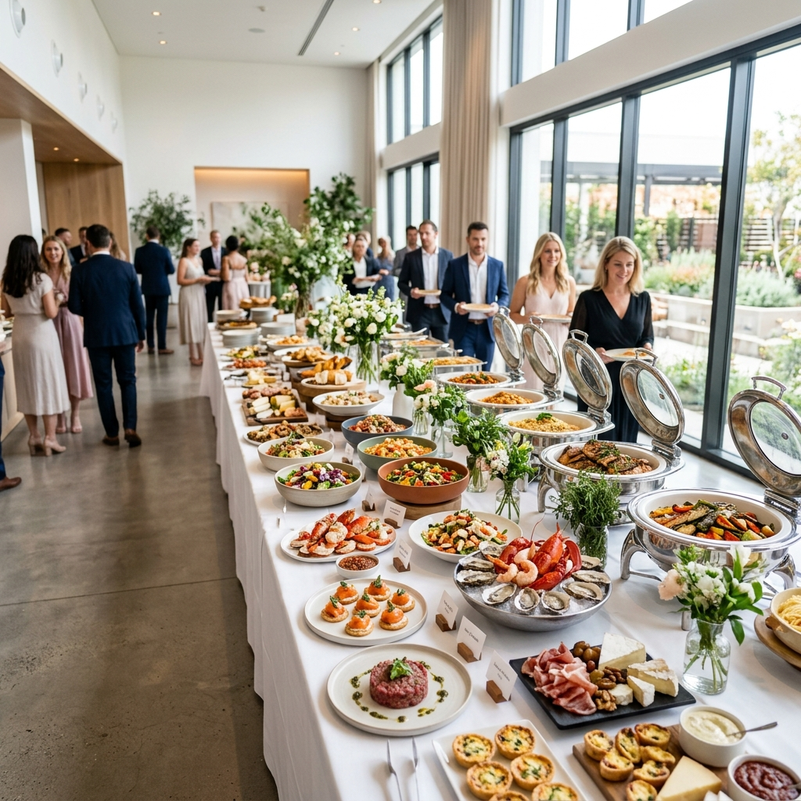

# Adasar Catering Web Sitesi

İstanbul'da hizmet veren Adasar Catering firması için geliştirilip satışa sunulan kurumsal web sitesi. Firma, teknik bilgiye ihtiyaç duymadan sitesini kendi yönetim panelinden güncelleyebilir.

**Canlı site:** [adasarcatering.com](https://adasarcatering.com)



## Özellikler

- Sünnet ve düğün, cenaze ve mevlüt, kurumsal yemek hizmetlerini tanıtan sayfalar
- Şifre korumalı yönetim paneli
- Panelden menü, fiyat, iletişim bilgisi ve sıkça sorulan soru düzenleme
- Panelden görsel yükleme
- Telefon ve bilgisayara uyumlu tasarım
- WhatsApp ve Instagram bağlantıları

## Teknolojiler

HTML, CSS, JavaScript, Node.js, Express

## Kurulum

```bash
npm install
cp .env.example .env
npm start
```

`.env` dosyasına kendi yönetici şifrenizi yazın. Site `http://localhost:8080` adresinde açılır.
